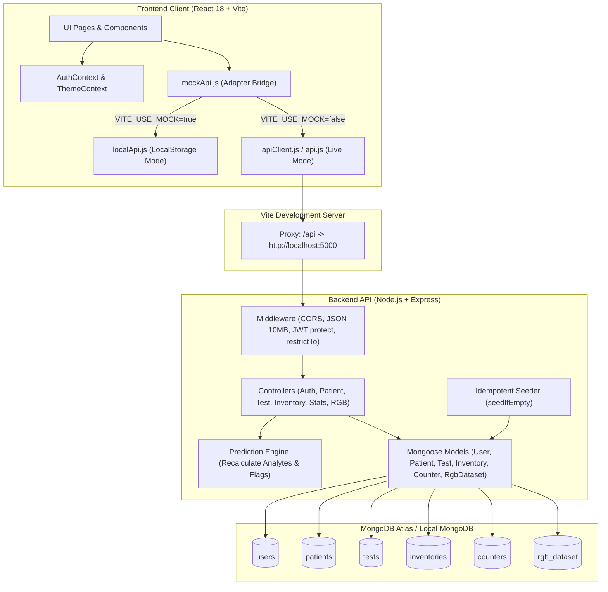

# Cura — Point-of-Care Urinalysis Portal

> **Cura** is a full-stack Point-of-Care Testing (POCT) urine test strip analysis and laboratory management platform. It digitizes reagent strip readings, provides automated non-linear concentration predictions for **10-panel** and **14-panel** urinalysis strips, enforces batch-level strip inventory and atomic stock consumption, prevents patient record duplication, and orchestrates an end-to-end clinician review and sign-off workflow.

---

## Table of Contents

- [1. Project Overview](#1-project-overview)
- [2. Key Features](#2-key-features)
- [3. Technology Stack](#3-technology-stack)
- [4. System Architecture](#4-system-architecture)
- [5. Project Structure](#5-project-structure)
- [6. Prerequisites](#6-prerequisites)
- [7. Installation and Setup](#7-installation-and-setup)
- [8. Environment Variables](#8-environment-variables)
- [9. Database Setup and Seeding](#9-database-setup-and-seeding)
- [10. API Documentation](#10-api-documentation)
- [11. Testing and Quality Checks](#11-testing-and-quality-checks)
- [12. Team Contributions](#12-team-contributions)
- [13. Troubleshooting](#13-troubleshooting)
- [14. Future Improvements](#14-future-improvements)

---

## 1. Project Overview

Clinical urinalysis is one of the most widely performed diagnostic screening tests in pathology laboratories, outpatient clinics, and hospital triage. Conventional point-of-care strip interpretation relies on visual color matching against static bottle charts, which is inherently vulnerable to subjective bias, ambient lighting variance, unrecorded lot numbers, and manual transcription errors.

**Cura** addresses these limitations by providing:
- **Digitized Reagent Pad Interpretation**: Reagent pad RGB triplets are mapped to concentration curves, reference ranges, and diagnostic flags using a non-linear colorimetric prediction engine.
- **Traceable Batch & Inventory Control**: Tests must be linked to active, unexpired inventory batches. Each test atomically consumes one test strip from the database to prevent stock discrepancies.
- **Strict Role-Based Clinical Workflow**: Segregated responsibilities for **Technicians** (patient intake, test execution), **Clinicians** (pathological verification, diagnostic notes, report sign-off), and **Admins** (laboratory batch provisioning, stock management).
- **Longitudinal Patient Health Records**: Tracks analyte concentrations over time, allowing clinicians to detect progression patterns such as diabetic microalbuminuria or renal impairment.

---

## 2. Key Features

### Role-Based Access Control (RBAC) & Authentication
- **Three Distinct User Roles**:
  - **Technician**: Registers patients, configures strip panels, enters reagent pad readings, and submits tests for clinical review.
  - **Clinician**: Accesses the triage review queue, inspects test abnormalities, records clinical notes, and signs off or flags re-tests.
  - **Admin**: Manages laboratory reagent inventory, tracks batch expiry dates, and adds/edits/deletes batch records.
- **Secure Authentication**: Passwords hashed using `bcryptjs` (salt rounds: 10), stateful session tokens issued via `jsonwebtoken` (JWT), and role protection enforced at both the route middleware level and frontend routing level.
- **Protected Public Signup**: Public registration permits `Technician` creation and gated `Clinician` registration (requiring an administrative invite code). Public self-assignment of the `Admin` role is strictly rejected by backend validation (`HTTP 400`).

### Reagent Strip Inventory & Stock Consumption
- **Batch Management**: Persists brand names, manufacturers, compatible panels (`10-panel`, `14-panel`), unique batch numbers, manufacture dates, expiry dates, and current strip quantities.
- **Atomic Stock Decrement**: Submitting a test atomically consumes exactly one strip using conditional database updates (`quantity: { $gt: 0 }`, `$inc: { quantity: -1 }`). If a batch has 0 strips or is expired, test creation is rejected (`HTTP 409` / `HTTP 400`).
- **Dynamic Strip Availability in Test Wizard**: Out-of-stock or expired brands appear disabled with clear visual cues and cannot be selected.
- **Admin Inventory Dashboard**: Dedicated interface for laboratory administrators to monitor batch stock levels, compute live status badges (*In stock*, *Out of stock*, *Expired*), and create, edit, or delete batch records.

### Patient Registration & Exact Duplicate Prevention
- **Exact 7-Field Duplicate Detection**: Rejects duplicate patient creation (`HTTP 409`) only when all seven core fields match an existing patient after normalization: `name`, `age`, `gender`, `phone`, `email`, `bloodGroup`, and `address`. Patients with identical names but different phone numbers or addresses are permitted.
- **Normalized International Phone Numbers**: Incorporates a country code dropdown (defaulting to India `+91`) and formats stored numbers into standardized E.164-compliant strings.
- **Duplicate Fingerprinting**: Computes a deterministic SHA-256 fingerprint on creation/update, supported by a sparse unique MongoDB index to prevent duplicate entries under race conditions.

### Test Analysis & Prediction Engine
- **Panel Support**:
  - **10-Panel Core**: Glucose, Protein, pH, Ketones, Blood, Bilirubin, Urobilinogen, Nitrite, Leucocytes, Specific Gravity.
  - **14-Panel Extended**: Adds **Ascorbic Acid, Calcium, Creatinine, and Microalbumin** for early screening of diabetic nephropathy and kidney disease.
- **RGB Colorimetry Engine**: Predicts analyte concentrations, assigns clinical units (`mg/dL`, `g/L`, `mg/L`), detects pathological flags (`normal`, `trace`, `abnormal`, `high_abnormal`), and provides model confidence scores.
- **Server-Side Verification**: The Express API recalculates all analyte values and flags on test submission, ensuring client-side predictions cannot be tampered with.
- **Preset Quick-Fill Controls**: Includes test shortcuts (*Load Normal*, *Load Pathological*, *Load High Abnormal*) for rapid testing and demonstrations.

### Clinician Review Workflow & Reports
- **Triage Review Queue**: Automatically routes submitted tests to the Clinician Review Queue, sorted abnormal-first to prioritize urgent findings.
- **Visual Status Timeline**: Interactive 3-stage progression tracker (*Submitted* → *Pending Review* → *Approved* or *Flagged for Re-test*).
- **Pathology Diagnostics Tagging**: Tags reports with target pathology providers (*Metropolis Healthcare, Dr Lal PathLabs, SRL Diagnostics, Thyrocare Laboratories, or In-house / K J Somaiya Hospital*).
- **Patient Trend Visualizations**: Longitudinal area and line charts (built using Recharts) displaying analyte trajectories across consecutive lab visits.

### Dual-Mode Architecture (Live API vs. Offline Mock)
- **Live Mode (`VITE_USE_MOCK=false`)**: Full end-to-end communication with the Express backend and MongoDB database.
- **Offline Mock Mode (`VITE_USE_MOCK=true`)**: Complete client-side simulation using browser `localStorage` and simulated network latency, supporting development without an active MongoDB connection.

---

## 3. Technology Stack

### Frontend
- **Framework**: [React 18](https://react.dev/) (`^18.3.1`, resolved `v18.3.1`)
- **Build Tool & Dev Server**: [Vite 5](https://vitejs.dev/) (`^5.4.1`, resolved `v5.4.21`)
- **Routing**: [React Router](https://reactrouter.com/) (`^6.26.0`, resolved `v6.30.6`)
- **Styling**: [Tailwind CSS](https://tailwindcss.com/) (`^3.4.10`, resolved `v3.4.19`) with Autoprefixer (`^10.4.20`) and PostCSS (`^8.4.41`)
- **Data Visualization**: [Recharts](https://recharts.org/) (`^2.12.7`, resolved `v2.15.4`)
- **Icons**: [Lucide React](https://lucide.dev/) (`^0.427.0`, resolved `v0.427.0`)
- **Form Handling & Utilities**: `react-hook-form` (`^7.52.1`), `clsx` (`^2.1.1`), `tailwind-merge` (`^2.5.2`)

### Backend
- **Runtime Environment**: [Node.js](https://nodejs.org/) (ES Modules, Node 18+)
- **Server Framework**: [Express](https://expressjs.com/) (`^4.22.3`, resolved `v4.22.3`)
- **Database ODM**: [Mongoose](https://mongoosejs.com/) (`^8.24.5`, resolved `v8.24.5`)
- **Authentication & Security**: [jsonwebtoken](https://github.com/auth0/node-jsonwebtoken) (`^9.0.3`, resolved `v9.0.3`), [bcryptjs](https://github.com/dcodeIO/bcrypt.js) (`^2.4.3`, resolved `v2.4.3`), [cors](https://expressjs.com/en/resources/middleware/cors.html) (`^2.8.6`, resolved `v2.8.6`)
- **Configuration**: [dotenv](https://github.com/motdotla/dotenv) (`^16.6.1`, resolved `v16.6.1`)

### Database
- **Database**: [MongoDB](https://www.mongodb.com/) (Local instance or MongoDB Atlas cluster)
- **Data Modeling**: Mongoose schemas with compound indexes, JSON serialization transforms (stripping internal `_id`, `__v`, and `password`), and atomic counter sequences.

### Development & Testing Tools
- **Linter**: [ESLint](https://eslint.org/) (`^10.12.0`, resolved `v10.12.0`)
- **Process Orchestration**: [Concurrently](https://github.com/open-cli-tools/concurrently) (`^9.2.1`, resolved `v9.2.5`)
- **Test Runner**: Node.js built-in assertion module (`node:assert/strict`)

---

## 4. System Architecture



### Architectural Highlights
1. **Frontend Isolation**: Frontend components never make direct, unabstracted `fetch()` or `axios` calls. All operations pass through `src/services/mockApi.js`, which transparently routes between the local storage simulation (`localApi.js`) and the authenticated HTTP client (`apiClient.js` / `api.js`).
2. **Authoritative Server Validation**: While the frontend predicts reagent pad readings in real time for immediate technician feedback, the Express server independently recomputes all analyte concentrations, ranges, and diagnostic flags using `src/services/predictionEngine.js` before writing to MongoDB.
3. **Timezone Uniformity**: All date comparisons (expiry checks, manufacture dates) are evaluated against Indian Standard Time (`Asia/Kolkata` / IST) regardless of client or server system clock timezone.

---

## 5. Project Structure

```text
uristrip-lab-portal/
├── index.html                           # Single-page application root HTML
├── package.json                         # Frontend dependencies and root orchestration scripts
├── vite.config.js                       # Vite server configuration and /api reverse proxy
├── tailwind.config.js                   # Tailwind color tokens, font configurations, clinical palette
├── .env.example                         # Template for frontend environment variables
├── server/                              # Node.js + Express backend service
│   ├── server.js                        # Express server entry point, routes, DB connection
│   ├── package.json                     # Backend dependencies and runner scripts
│   ├── .env.example                     # Template for backend environment variables
│   ├── config/
│   │   ├── db.js                        # Mongoose connection with optional custom DNS resolver
│   │   └── corsConfig.js                # Allowed origin resolution and CORS middleware options
│   ├── controllers/
│   │   ├── authController.js            # User signup, login, session lookup, password change
│   │   ├── patientController.js         # Patient creation, 7-field duplicate check, search
│   │   ├── testController.js            # Test creation, atomic stock consumption, reviews
│   │   ├── inventoryController.js       # Inventory batch listing and Admin CRUD
│   │   ├── statController.js            # Dashboard metric aggregations
│   │   └── rgbDatasetController.js      # Reference RGB calibration dataset lookup
│   ├── middleware/
│   │   ├── auth.js                      # JWT verification (protect) and RBAC guard (restrictTo)
│   │   └── errorHandler.js              # Centralized error handler and HTTP status formatter
│   ├── models/
│   │   ├── User.js                      # User schema (Technician, Clinician, Admin)
│   │   ├── Patient.js                   # Patient schema with unique duplicateFingerprint
│   │   ├── Test.js                      # Urinalysis test records, analyte subdocuments, review state
│   │   ├── Inventory.js                 # Reagent batch stock records and compound index
│   │   ├── Counter.js                   # Atomic sequence counters for PAT- and CUR- codes
│   │   └── RgbDataset.js                # Calibration RGB reference samples
│   ├── routes/                          # Express route definitions
│   │   ├── authRoutes.js                # /api/auth and /api/users
│   │   ├── patientRoutes.js             # /api/patients
│   │   ├── testRoutes.js                # /api/tests
│   │   ├── inventoryRoutes.js           # /api/inventory
│   │   ├── statRoutes.js                # /api/stats
│   │   └── rgbDatasetRoutes.js          # /api/rgb-dataset
│   ├── seed/
│   │   └── seedRunner.js                # Idempotent database seeder (seedIfEmpty)
│   ├── test/                            # Isolated contract and unit tests
│   │   ├── safeEndpointContracts.test.js # 50 unit and contract assertions
│   │   └── inventoryContracts.test.js   # 13 isolated inventory and stock tests
│   └── utils/
│       ├── asyncHandler.js              # Promise rejection catcher for route handlers
│       ├── codes.js                     # Atomic human-readable code generator
│       ├── jsonTransform.js             # Mongoose plugin stripping internal database properties
│       ├── patientNormalization.js      # Phone and field normalization and fingerprinting
│       └── validation.js                # Batch, brand, date, and stock validators
├── src/                                 # React application source code
│   ├── App.jsx                          # Root router, ProtectedRoute, and RoleRoute wrappers
│   ├── main.jsx                         # React DOM mount point
│   ├── index.css                        # Global styles, Tailwind directives, dark mode styling
│   ├── components/
│   │   ├── common/                      # Reusable UI primitives (Modal, Badge, Avatar, BrandLogo)
│   │   ├── layout/                      # Navigation, Sidebar, MobileNav, AppLayout, Header
│   │   ├── patient/                     # Patient search, cards, demographics display
│   │   ├── review/                      # ReviewModal, ReviewTimeline, sign-off controls
│   │   └── wizard/                      # New test multi-step wizard
│   │       ├── StepPatientDestination.jsx # Patient selection, modal, country code picker
│   │       ├── StepStripSelection.jsx   # Brand & batch selection, stock availability checks
│   │       ├── StepPadReading.jsx       # RGB color inputs, color swatches, diagnostic presets
│   │       └── StepReviewSubmit.jsx     # Final summary review, disclaimer, submission
│   ├── context/
│   │   ├── AuthContext.jsx              # Session state, login, logout, role helpers (isAdmin, etc.)
│   │   ├── ThemeContext.jsx             # Persistent dark/light theme state
│   │   └── ToastContext.jsx             # Toast notification dispatch and rendering
│   ├── pages/                           # Application route views
│   │   ├── DashboardPage.jsx            # Lab statistics, recent tests, quick action triggers
│   │   ├── InventoryPage.jsx            # Admin-only batch stock dashboard and CRUD modals
│   │   ├── LoginPage.jsx                # Authentication form with quick-fill demo buttons
│   │   ├── SignupPage.jsx               # User registration (Technician / Clinician with code)
│   │   ├── NewTestPage.jsx              # Multi-step urinalysis execution wizard
│   │   ├── PatientsPage.jsx             # Directory of registered patients
│   │   ├── PatientDetailPage.jsx        # Patient demographics, history, Recharts trends
│   │   ├── ReportsPage.jsx              # Searchable and filterable archive of completed tests
│   │   ├── ReportDetailPage.jsx         # Detailed lab report view, clinician review actions
│   │   ├── ReviewQueuePage.jsx          # Clinician review queue (abnormal-first triage)
│   │   └── ProfilePage.jsx              # User profile update and password change
│   ├── services/
│   │   ├── api.js                       # High-level HTTP API methods
│   │   ├── apiClient.js                 # Low-level Fetch wrapper handling JWT headers & errors
│   │   ├── localApi.js                  # LocalStorage mock API implementing full contract
│   │   ├── mockApi.js                   # Mode selector exporting active API client
│   │   ├── predictionEngine.js          # Non-linear RGB-to-analyte concentration model
│   │   └── seedData.js                  # Static fixture users, patients, tests, and inventory
│   └── utils/
│       ├── formatters.js                # Date, time, phone, and clinical value formatting
│       └── stripConfig.js               # Reagent pad metadata and color reference tables
```

---

## 6. Prerequisites

Ensure your development machine has the following tools installed:

- **Node.js**: `v18.x` or `v20.x` (LTS recommended)
- **npm**: `v9.x` or `v10.x`
- **MongoDB**: Either an active **MongoDB Atlas** connection URI or a local **MongoDB Community Server** instance (`mongod`) running on port `27017`
- **Shell**: PowerShell (Windows), bash, or zsh (macOS/Linux)

---

## 7. Installation and Setup

### 1. Clone the Repository
Open Windows PowerShell and clone the project:

```powershell
git clone https://github.com/Nidhi1014858/uristrip-lab-portal.git
cd uristrip-lab-portal
```

### 2. Install Dependencies
Run the convenience script from the project root to install dependencies for both the frontend and the backend:

```powershell
npm run install:all
```

*(Alternatively, run `npm install` in the root folder and `npm install` inside the `server/` folder).*

### 3. Configure Environment Files

Create the frontend environment file `.env` in the root folder:

```powershell
Copy-Item .env.example .env
```

Create the backend environment file `server/.env` in the `server/` folder:

```powershell
Copy-Item server/.env.example server/.env
```

Edit `server/.env` and supply your database connection string and a secure random JWT secret.

### 4. Run the Development Servers

#### Option A: Run Both Concurrently (Recommended)
From the project root:

```powershell
npm run dev:all
```

#### Option B: Run in Separate Terminals

**Terminal 1 (Backend Express API):**
```powershell
npm run server
```
*The server starts on `http://localhost:5000` and automatically runs initial database seeding.*

**Terminal 2 (Frontend React App):**
```powershell
npm run dev
```
*The Vite development server starts on `http://localhost:3000` (or `http://localhost:5173`).*

Open **`http://localhost:3000`** in your browser.

---

## 8. Environment Variables

### Frontend Configuration (`.env`)

| Variable | Required | Default | Description |
|---|:---:|:---:|---|
| `VITE_USE_MOCK` | No | `false` | When set to `true`, the frontend runs in offline mode using `localStorage`. When `false` or omitted, requests are proxied to the live backend. |

### Backend Configuration (`server/.env`)

| Variable | Required | Default | Description |
|---|:---:|:---:|---|
| `PORT` | No | `5000` | Port number on which the Express server listens. |
| `MONGO_URI` | **Yes** | — | MongoDB connection string (e.g., `mongodb+srv://<user>:<password>@cluster.mongodb.net/cura?retryWrites=true&w=majority` or `mongodb://localhost:27017/cura`). |
| `JWT_SECRET` | **Yes** | — | Cryptographic secret key used to sign and verify JSON Web Tokens. |
| `JWT_EXPIRES_IN` | No | `7d` | Lifetime of issued JWT authentication tokens (e.g., `7d`, `24h`). |
| `DNS_SERVERS` | No | — | Comma-separated list of custom DNS servers (e.g., `8.8.8.8,1.1.1.1`). Required on networks where Node encounters `querySrv ECONNREFUSED` resolving MongoDB Atlas SRV records. |
| `CORS_ORIGINS` | No | — | Comma-separated list of additional allowed web origins. Defaults include `localhost:3000`, `127.0.0.1:3000`, `localhost:5173`, and `127.0.0.1:5173`. |
| `CLINICIAN_INVITE_CODE` | No | — | Shared secret required during public registration to assign a user the `Clinician` role. |

> [!WARNING]
> Never commit `.env` or `server/.env` files containing real production database passwords, JWT secrets, or administrative credentials to version control.

---

## 9. Database Setup and Seeding

### Initial Connection
When the Express application starts, `server/server.js` connects to MongoDB via Mongoose:
- Verifies that both `MONGO_URI` and `JWT_SECRET` are defined (terminating the process with an informative error if absent).
- Automatically configures custom DNS servers if `DNS_SERVERS` is set.
- Initializes Mongoose schema indexes, including compound unique constraints on inventory and sparse unique indexes on patient duplicate fingerprints.

### Automatic Idempotent Seeding
On server boot, `seedIfEmpty()` in `server/seed/seedRunner.js` runs automatically:
- **Users**: Upserts pre-configured accounts without resetting existing passwords.
- **Patients**: Seeds baseline patient demographic records and computes their duplicate fingerprints.
- **Historical Tests**: Inserts baseline test records mapped to seeded patient IDs if their `testCode` does not already exist.
- **Inventory Batches**: Inserts initial batches of reagent test strips (`CUR-10-2401`, `CUR-14-2401`, etc.) if not already present.

### Default Demonstration Accounts

The database seeder provisions three role-specific evaluation accounts for development and testing:

| Role | Email | Password | Primary Permissions |
|---|---|---|---|
| **Lab Technician** | `tech@cura.lab` | `password123` | Patient intake, test execution, pad RGB reading entry |
| **Clinician Pathologist** | `clinician@cura.lab` | `password123` | Triage review queue, report sign-off, diagnostic notes |
| **Lab Systems Admin** | `admin@cura.lab` | `password123` | Laboratory inventory management, batch creation/deletion |

*Quick-login buttons for all three accounts are available directly on the login page.*

> [!IMPORTANT]
> The seeded evaluation credentials (`password123`) are provided strictly for local development, academic demonstrations, and automated contract testing. They should never be used, deployed, or retained in production environments.

---

## 10. API Documentation

All protected endpoints require an `Authorization` header containing a valid Bearer token: `Authorization: Bearer <your-jwt-token>`.

### Public & Health Endpoints

| Method | Endpoint | Access | Description |
|---|---|:---:|---|
| `GET` | `/` | Public | Returns server identity and health link. |
| `GET` | `/api/health` | Public | Returns `{ status: "ok" }` for monitoring and uptime probes. |

### Authentication & Users

| Method | Endpoint | Access | Description |
|---|---|:---:|---|
| `POST` | `/api/auth/signup` | Public | Registers a new user (`Technician` by default; `Clinician` requires `CLINICIAN_INVITE_CODE`; `Admin` is rejected with `400`). Returns `{ token, user }`. |
| `POST` | `/api/auth/login` | Public | Authenticates credentials and returns `{ token, user }`. |
| `GET` | `/api/auth/me` | Authenticated | Retrieves profile of currently authenticated user. |
| `PATCH` | `/api/auth/password` | Authenticated | Changes current user password (`currentPassword`, `newPassword`). |
| `PATCH` | `/api/users/:id` | Authenticated (Self) | Updates user profile (name, designation, department, photo). Rejects role changes. |

### Patients

| Method | Endpoint | Access | Description |
|---|---|:---:|---|
| `GET` | `/api/patients` | Authenticated | Lists patients. Supports search filtering via query parameter `?search=`. |
| `POST` | `/api/patients` | Authenticated | Registers a new patient. Rejects exact 7-field duplicates with `HTTP 409`. |
| `GET` | `/api/patients/:id` | Authenticated | Retrieves single patient record and their historical tests. |
| `PATCH` / `PUT` | `/api/patients/:id` | Tech / Clinician | Updates patient demographics and recalculates duplicate fingerprint. |

### Tests & Urinalysis

| Method | Endpoint | Access | Description |
|---|---|:---:|---|
| `GET` | `/api/tests` | Authenticated | Lists urinalysis tests with filtering (`search`, `patientId`, `panelType`, `status`, `reviewed`, `dateFrom`, `dateTo`, `page`, `limit`). |
| `POST` | `/api/tests` | **Technician** | Validates batch stock, atomically decrements strip quantity by 1, recalculates analytes from RGB values, and creates test. |
| `GET` | `/api/tests/batches/:batchNumber` | Authenticated | Retrieves batch usage statistics and historical tests for a given lot number. |
| `GET` | `/api/tests/:id` | Authenticated | Retrieves test details by database ID or human-readable `testCode`. |
| `PATCH` | `/api/tests/:id/review` | **Clinician** | Signs off on test (`approved`) or requests re-test (`flagged_retest`) with clinician notes. |

### Reagent Strip Inventory

| Method | Endpoint | Access | Description |
|---|---|:---:|---|
| `GET` | `/api/inventory` | Authenticated | Lists reagent batches. Supports filters: `?panelType=10-panel|14-panel` and `?availableOnly=true`. |
| `GET` | `/api/inventory/:id` | Authenticated | Retrieves details of a single inventory batch. |
| `POST` | `/api/inventory` | **Admin** | Creates a new strip batch. Validates calendar dates, positive quantity, and case-insensitive batch uniqueness within the brand (`HTTP 409` on collision). |
| `PATCH` | `/api/inventory/:id` | **Admin** | Updates batch details (e.g., received stock quantity, dates). |
| `DELETE` | `/api/inventory/:id` | **Admin** | Deletes an inventory batch record after confirmation. |

### Dashboard & Calibration Data

| Method | Endpoint | Access | Description |
|---|---|:---:|---|
| `GET` | `/api/stats/dashboard` | Authenticated | Aggregates lab statistics (total tests, pending reviews, abnormal percentage, active patients, recent activity). |
| `GET` | `/api/rgb-dataset` | Authenticated | Retrieves reference RGB calibration dataset samples from the `rgb_dataset` collection. |

---

## 11. Testing and Quality Checks

The repository includes isolated contract tests that run without mutating live MongoDB database data:

### Run Safe Contract Tests
Validates authentication guards, role restrictions, Indian Standard Time date checks, RGB concentration calculations, duplicate fingerprinting, and API contracts (50 tests):

```powershell
node server/test/safeEndpointContracts.test.js
```

### Run Inventory & Stock Consumption Tests
Validates batch schema validation, atomic stock decrementing, race-condition defenses, and Admin-only mutations (13 tests):

```powershell
node server/test/inventoryContracts.test.js
```

### Run Code Linting
Executes ESLint across all JavaScript and JSX source files:

```powershell
npm run lint
```

### Run Production Build
Compiles frontend assets using Vite and Rollup:

```powershell
npm run build
```

> [!NOTE]
> In environments where the project directory is accessed through a Windows junction or symbolic link, run `npm run build` from the resolved physical path to ensure Rollup correctly resolves relative HTML asset paths.

### Security Vulnerability Status
A project dependency audit was conducted. While direct dependencies (`source-map-js` upgraded from `1.2.1` to `1.2.2`) have been safely patched, 11 vulnerabilities (5 moderate, 6 high) in transitive dependencies (`braces`, `micromatch`, `esbuild`, `postcss-selector-parser`, and `react-router` / `react-router-dom`) remain open. They have intentionally not been forcefully upgraded via `npm audit fix --force` because npm reports that resolving them requires breaking major upgrades to Tailwind CSS v4, Vite v8, and React Router v7.

---

## 12. Team Contributions

This mini-project was designed, developed, and tested by team members with clearly demarcated responsibilities:

### 1. Rimjhim — Person 1: Inventory Data, Stock Consumption, and Strip Availability
- **Mongoose Inventory Schema (`server/models/Inventory.js`)**: Modeled batch records with normalized batch numbers, calendar date validators, and brand-batch compound unique indexing.
- **Atomic Stock Decrement (`server/controllers/testController.js`)**: Implemented atomic strip deduction (`findOneAndUpdate({ _id, quantity: { $gt: 0 } }, { $inc: { quantity: -1 } })`) during test creation, ensuring stock never drops below zero.
- **Dynamic Wizard Availability (`src/components/wizard/StepStripSelection.jsx`)**: Connected the strip selection wizard step to live inventory, dynamically locking out and disabling out-of-stock or expired strip brands.
- **Inventory Service & Tests**: Created inventory contract test suites (`server/test/inventoryContracts.test.js`) and mock-mode inventory parity in `localApi.js`.

### 2. Nidhi — Person 2: Admin Role, Authorization, and Inventory Management UI
- **Admin Role & Security Architecture**: Extended the `User.js` role enum to include `Admin`. Enforced backend restrictions in `server/controllers/authController.js` to ensure public registration rejects the `Admin` role with `HTTP 400`.
- **Idempotent Admin Seeding (`server/seed/seedRunner.js`)**: Seeded the development admin account (`admin@cura.lab`) without overwriting existing passwords on server restarts.
- **Admin UI & Route Protection (`src/App.jsx`, `src/context/AuthContext.jsx`)**: Added `isAdmin` context helper, configured `RoleRoute` protection for `/inventory`, and conditioned desktop and mobile sidebar navigation links.
- **Inventory Management Interface (`src/pages/InventoryPage.jsx`)**: Built the full administrator inventory management dashboard, including live status badges, add/edit batch dialogs, delete confirmation workflows, and client-side validation.
- **Mutation Route Guarding**: Restricted `POST`, `PATCH`, and `DELETE` on `/api/inventory` strictly to `Admin` using `restrictTo('Admin')` in Express and corresponding role checks in `localApi.js`.

### 3. Surbhi — Person 3: Patient Duplicate Check and Phone Country Codes
- **7-Field Exact Duplicate Prevention (`server/controllers/patientController.js`)**: Built the logic comparing `name`, `age`, `gender`, `phone`, `email`, `bloodGroup`, and `address`, returning `HTTP 409 Conflict` only when all seven fields match an existing patient.
- **Duplicate Fingerprinting (`server/models/Patient.js`, `server/utils/patientNormalization.js`)**: Implemented deterministic SHA-256 fingerprint generation and a sparse unique index to prevent duplicate patient insertions under concurrent requests.
- **International Country Code Selector (`src/components/wizard/StepPatientDestination.jsx`)**: Added a searchable country dial code picker (defaulting to India `+91`), national phone input, and formatted E.164 phone number persistence.
- **Modal Error Handling**: Enhanced the patient creation modal to remain open on duplicate conflict, preserving entered fields and presenting clear inline feedback.

---

## 13. Troubleshooting

### 1. MongoDB Atlas SRV Timeout (`querySrv ECONNREFUSED`)
- **Cause**: Some local ISP DNS resolvers or firewalls block or drop DNS SRV record lookups for MongoDB Atlas cluster addresses.
- **Solution**: Open `server/.env` and uncomment/set the Google and Cloudflare DNS fallback:
  ```bash
  DNS_SERVERS=8.8.8.8,1.1.1.1
  ```
  Restart the server. `server/config/db.js` will route database name resolution through these reliable servers.

### 2. Port Conflicts (`EADDRINUSE: port 5000` or `3000`)
- **Cause**: A previous instance of Node or another local service is holding port 5000 or 3000.
- **Solution**: In PowerShell, identify and terminate the occupying process:
  ```powershell
  Get-Process -Id (Get-NetTCPConnection -LocalPort 5000).OwningProcess | Stop-Process -Force
  ```
  Alternatively, specify a different port in `server/.env` (e.g., `PORT=5001`).

### 3. Clinician Registration Fails with HTTP 403 Forbidden
- **Cause**: The server has configured `CLINICIAN_INVITE_CODE` in `server/.env`, but the signup form did not include a matching code.
- **Solution**: Enter the matching invite code in the registration dialog, or leave `CLINICIAN_INVITE_CODE` unset in development to allow open Clinician signup. (Note: pre-seeded `clinician@cura.lab` can be logged into directly without an invite code).

### 4. Admin Registration Returns HTTP 400 Bad Request
- **Cause**: The application explicitly prohibits public self-registration of Admin accounts for security reasons.
- **Solution**: Use the pre-seeded development account (`admin@cura.lab` / `password123`) or provision administrative accounts directly in MongoDB.

### 5. Frontend Fails to Connect to Backend (`Network Error` / `ECONNREFUSED`)
- **Cause**: The backend API server is not running, or Vite is configured with `VITE_USE_MOCK=false` while the Express server is stopped.
- **Solution**: Verify that `npm run server` is running on port 5000. If you wish to test offline without starting the backend, set `VITE_USE_MOCK=true` in `.env` and restart Vite.

---

## 14. Future Improvements

The following features and enhancements are planned for future releases:

1. **Computer Vision & Camera Capture**:
   - Automated strip alignment and reagent pad cropping via WebRTC camera streaming and OpenCV.js.
   - Automatic reference color card calibration to eliminate the need for manual RGB triplet entry.
2. **EHR / Hospital Information System Interoperability**:
   - Export clinical lab reports formatted as standard HL7 FHIR (Fast Healthcare Interoperability Resources) Observation resources.
   - Direct bidirectional integration with hospital laboratory information systems (LIS).
3. **Offline Field Clinic Sync (Progressive Web App)**:
   - Enhanced service workers and IndexedDB storage to allow mobile health workers to execute tests completely offline and automatically synchronize records when internet connectivity is restored.
4. **Real-Time Notification Pipeline**:
   - Integration of Server-Sent Events (SSE) or WebSockets to instantly notify clinicians when an abnormal test requiring urgent review is submitted.
5. **Transitive Dependency Modernization**:
   - Gradual migration of toolchain packages to resolve outstanding audit advisories once compatible major versions of Vite, Tailwind CSS, and React Router are certified across the project.
